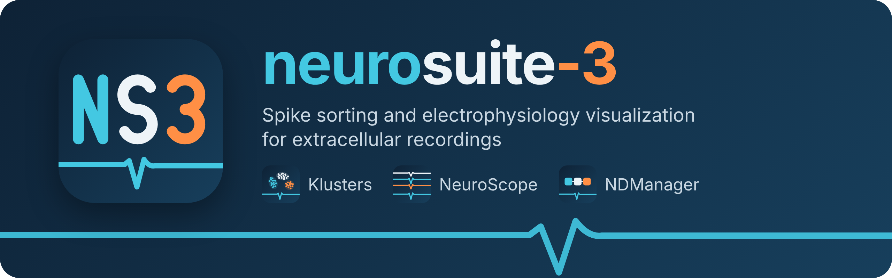
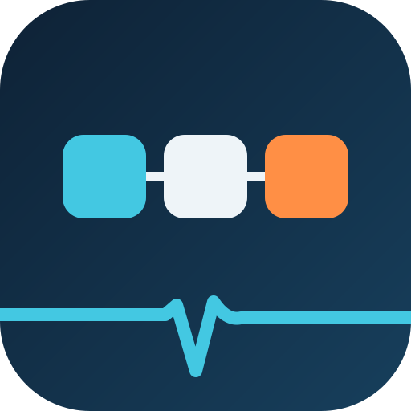
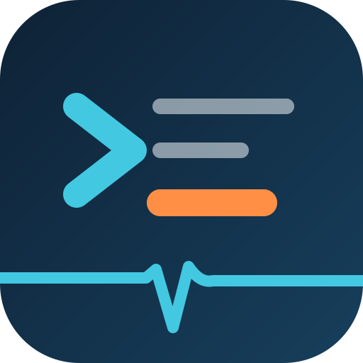
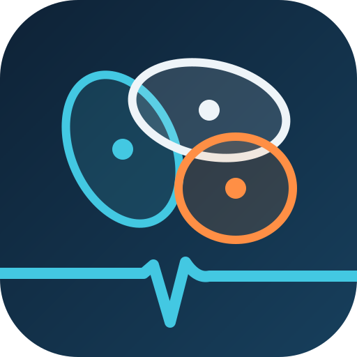
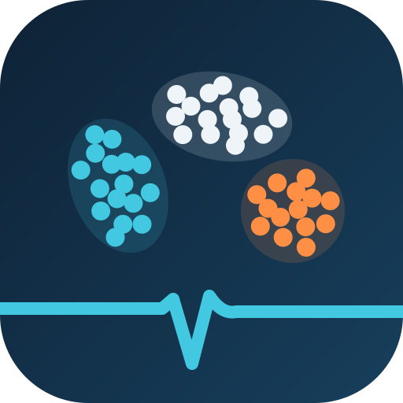
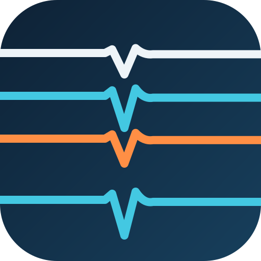

<h1><picture>
  <source media="(max-width: 600px)" srcset="doc/images/banner-narrow.png">
  
</picture></h1>

Spike sorting and electrophysiology visualization: a **Qt 6 / C++20** revival of [Neurosuite](https://buzsakilab.com/wp/resources/neurosuite/), the toolchain for extracellular recordings that **Lynn Hazan** wrote in **György Buzsáki**'s lab with **Michaël Zugaro** (Hazan, Zugaro & Buzsáki, *J. Neurosci. Methods* 155:207–216, 2006; [github.com/neurosuite](https://github.com/neurosuite)). KiloKlustaKwik builds on **Kenneth D. Harris**'s KlustaKwik.

From a raw recording to sorted single units: convert and filter the signal, detect and sort spikes automatically, curate by hand, and check everything against the LFP, events and the animal's position. GPU acceleration is optional; a CPU build is always produced.

## Start here

| To… | Read |
|---|---|
| Sort your first recording | [First-time spike sort](doc/workflows/first-time-sort.md) |
| Install or build | [INSTALL.md](doc/INSTALL.md) (Linux, Windows, macOS) · [BUILD.md](doc/BUILD.md) (options) |
| Learn the programs | [User and pipeline docs](doc/README.md) · [NeuroScope handbook](doc/site/docs/handbook/01-introduction.md) · in every app: **Help ▸ Handbook** (F1) |
| Look up a term | [Glossary](doc/GLOSSARY.md) |
| Work on the code | [Developer guide](doc/dev/DEVELOPER_GUIDE.md) · [Contributing](.github/CONTRIBUTING.md) |

All documentation online: **https://gravios.github.io/neurosuite-3/** [](https://github.com/Gravios/neurosuite-3/actions/workflows/docs.yml)

## Quick start

**Linux and macOS**

```bash
git clone https://github.com/Gravios/neurosuite-3.git
cd neurosuite-3
cmake -B build -DCMAKE_INSTALL_PREFIX="$HOME/.local" -DNS_INSTALL_DEPS=ON
cmake --build build --parallel
cmake --install build
```

**Windows**

```bat
scripts\install-deps-windows.bat
cmake --preset windows
cmake --build --preset windows
cmake --install build
```

- `-DNS_INSTALL_DEPS=ON` installs the required packages (apt, Homebrew, vcpkg); leave it out to manage them yourself. On Windows, `install-deps-windows.bat` installs the compiler, the libraries (vcpkg) and Qt, and the install puts the programs on your `PATH`.
- Build types, GPU backends, skipping a component (`-DNS_SKIP_KILOKLUSTAKWIK=ON`), sanitizers and reproducing CI: [BUILD.md](doc/BUILD.md). Each platform step by step: [INSTALL.md](doc/INSTALL.md).

## Platforms

| Platform | Builds | Tests in CI | Notes |
|---|---|---|---|
| **Linux**<br>[](https://github.com/Gravios/neurosuite-3/actions/workflows/ci-linux.yml) | Everything | Required | Ubuntu 24.04 and newer, Debian 12, WSL2. The reference platform: CI on Ubuntu 24.04, 25.10, 26.04 and 26.10. Oldest Qt: 6.4. |
| **Windows 10 / 11**<br>[](https://github.com/Gravios/neurosuite-3/actions/workflows/ci-windows.yml) | All but KiloKlustaKwik | Not yet | Visual Studio 2022. The `ndm_*` steps run from cmd and PowerShell through Git Bash. For KiloKlustaKwik, or the whole pipeline, use WSL2. |
| **macOS**<br>[](https://github.com/Gravios/neurosuite-3/actions/workflows/ci-macos.yml) | Everything | Informational | Apple silicon, Homebrew. Metal (Apple GPU) and Accelerate paths. The `ndm_*` steps need bash 4: `brew install bash`. |

## The programs

<details>
<summary> <b>NDManager</b>: set up a session and its pipeline</summary>

- Edits the session `.yaml`: acquisition, probes and channel groups, and every step's parameters with their help; an **Add** list shows the parameters a step reads.
- A Pipeline tab that builds and saves the processing pipeline as a graph, with the plugins grouped by purpose.
- Session templates to export and apply, and a probe library (43 NeuroNexus models) with a geometry editor.
- It edits the pipeline; the steps themselves run in a terminal.

Manual: [doc/ndmanager/README.md](doc/ndmanager/README.md)

</details>

<details>
<summary> <b>ndmanager-plugins</b>: the command-line pipeline</summary>

- `ndm_*` steps (bash, driving C++ `process_*` programs and Python modules) from a raw recording to sorted spikes.
- **Conversion:** Neuralynx, CED, AlphaOmega and Plexon (`.plx`, `.pl2`) to `.dat`; the AlphaOmega and Plexon converters also fill in the session file.
- **Detection and features:** a zero-phase Butterworth high-pass by default, spatial-derivative detection (`sdiff`, `stderiv`), extraction, PCA. Every per-group file is named for its method (`SESSION.<type>.<method>.N`), so methods coexist in one session.
- **After sorting:** re-extraction at a lower threshold, spike subtraction (`ndm_stripdat`) and re-detection, drift estimation and correction, collision decomposition, localisation, learned curation (`ndm_autoklusta`), empirical priors from curation logs.
- External sorters plug in through the ndm plugin protocol, for example [fiber-kit](https://github.com/Gravios/fiber-kit) as `ndm_fiber-kit` ([details](doc/ndmanager-plugins/commands/ndm_klustakwik.md#external-sorter-ndm_fiber-kit)).

Manual: [doc/ndmanager-plugins/README.md](doc/ndmanager-plugins/README.md)

</details>

<details>
<summary> <b>KiloKlustaKwik</b>: automatic spike sorting</summary>

- Classification EM on the features of each group (`.fet.<method>.N` to `.clu.<method>.N`), built on Kenneth D. Harris's KlustaKwik.
- Chunked for multi-hour recordings with electrode drift; `-ChunkMinutes 0` gives the original two-phase CEM.
- Three-tier parameters (group, session, defaults), waveform realignment built in, and GPU E-steps (CUDA, HIP, SYCL, Metal).

Manual: [doc/kiloklustakwik/README.md](doc/kiloklustakwik/README.md)

</details>

<details>
<summary> <b>Klusters</b>: curate the clusters by hand</summary>

- One electrode group at a time in synchronized views: inspect, split, merge and reassign clusters, every edit undoable.
- [Hierarchical clustering](doc/klusters/hierarchical-clustering.md) into fibers and atoms, template curation, t-SNE and oblique views, multi-lasso, DipSplit and watershed splits, merge recommendations, drift / template / residual matrices, waveform realignment.
- Rebindable keys and mouse, and a right-click radial menu.
- All-or-nothing saves that skip unchanged files, autosave for crash recovery, and a curation log (`.cur`) that the curation and prior-training tools learn from.

Manual: [doc/klusters/README.md](doc/klusters/README.md)

</details>

<details>
<summary> <b>NeuroScope</b>: view signals, spikes, events and position</summary>

- Scrollable multi-channel traces of the wideband, LFP or filtered file, with spikes, waveforms, clusters, events and the animal's position overlaid.
- A multitaper spectral view, several display tabs, and a session file (`.nrs`) that remembers the display.
- The [NeuroScope handbook](doc/site/docs/handbook/01-introduction.md) is built in: **Help ▸ Handbook** (F1).

Manual: [doc/neuroscope/README.md](doc/neuroscope/README.md)

</details>

- **One session file.** Every tool reads the session `.yaml`; start from [`templates/template.yaml`](templates/template.yaml). Convert a legacy `.xml` with `ndm_xml2yaml`: the GUIs read YAML only (Klusters also opens `.par`), and only the `ndm_*` scripts still read `.xml`.
- **Shared libraries:** libklustersshared (Qt widgets, the key and mouse binding engine, YAML parameter I/O) and [libneurosuite-core](src/libneurosuite-core/docs/FILE_FORMATS.md) (Qt-free reading and writing of every file format).

## Workflows

Walkthroughs across the toolchain; begin with the first.

- [First-time spike sort](doc/workflows/first-time-sort.md): acquire, preprocess, sort, curate
- [Cluster curation](doc/workflows/cluster-curation.md): split, merge, realign and nudge in Klusters
- [Re-extract with a lower threshold](doc/workflows/re-extract-lower-threshold.md): recover weak units
- [Iterative refinement](doc/workflows/iterative-refinement.md): strip, re-detect, re-sort
- [Drift correction](doc/workflows/drift-correction.md) · [Collision decomposition](doc/workflows/collision-decomposition.md) · [Empirical priors](doc/workflows/empirical-priors.md)

## GPU acceleration

Optional and detected at build time; the CPU (OpenMP) path is always built.

| Component | CUDA | HIP | SYCL | Metal | Accelerates |
|---|:-:|:-:|:-:|:-:|---|
| kiloklustakwik | ✓ | ✓ | ✓ | ✓ | CEM E-step, waveform realignment |
| klusters | ✓ | ✓ | ✓ | ✓ | Grouping Assistant, interactive realignment |
| neuroscope | ✓ | | | | Spectrogram FFT (cuFFT) |
| `ndm_hipass` | ✓¹ | | | ✓ | Butterworth and median high-pass filters |
| `ndm_detectspikes` | ✓ | | | ✓ | Noise thresholds |
| `ndm_spikegrouper` | ✓ | | | ✓ | Channel grouping |
| `ndm_extractemg` | ✓ | ✓ | ✓ | | EMG extraction |
| `ndm_decomposecollisions` | opt-in | | | | Collision decomposition fit |

¹ The CUDA Butterworth kernel is not yet validated on hardware. Metal results are still to be compared with the CPU on a Mac (`scripts/metal_validate.sh`).

Toolkit setup (CUDA including Blackwell / sm_120, ROCm, oneAPI): [BUILD.md §4](doc/BUILD.md) · [doc/gpu](doc/gpu/README.md).

## Across the suite

- **Qt 6 / C++20** in every program, one YAML parameter format, native Windows and macOS builds.
- **Optional GPU acceleration** with a CPU path always built (see [GPU acceleration](#gpu-acceleration)).
- **Current manuals** in every program (**F1**) and [online](https://gravios.github.io/neurosuite-3/).

Full history: [CHANGELOG.md](CHANGELOG.md).

## Contributing

Patch discipline, coding standards and the build-and-verify workflow: [CONTRIBUTING.md](.github/CONTRIBUTING.md). Architecture and internals: [DEVELOPER_GUIDE.md](doc/dev/DEVELOPER_GUIDE.md).

## License

neurosuite-3 is free software under the **GNU General Public License, version 3 or (at your option) any later version**, with no warranty; see [LICENSE](LICENSE).

Bundled third-party parts keep their own compatible licenses:

| Part | License |
|---|---|
| Vendored libsamplerate fallback | GPL-2.0-or-later |
| KDE-derived page-dialog classes (`libklustersshared/src/gui/page/`) | LGPL-2.0-or-later |
| Qt-derived helper in `ndmanager` | LGPL-2.1 / GPL-3.0 |
| Oxygen icons | LGPL-3.0-or-later |
