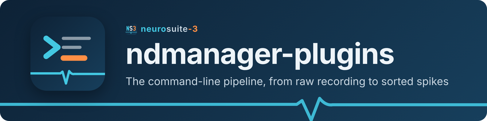

<h1><picture>
  <source media="(max-width: 600px)" srcset="banner-narrow.png">
  
</picture></h1>

ndmanager-plugins are the command-line steps that take a raw recording to
sorted spikes and beyond: format conversion, filtering, spike detection and
extraction, features, KiloKlustaKwik clustering, and post-sorting analyses
(re-extraction, spike subtraction, collision decomposition, localisation,
drift estimation and correction). Each step is an `ndm_*` bash script driving
C++ binaries (`process_*`, some with CUDA) and Python modules. ndmanager edits
their parameters and arranges them into pipelines.

## Start here

| | |
|---|---|
| **[Pipeline overview](pipeline.md)** | Which steps run in which order, from acquisition to drift correction |
| **[Parameters](parameters.md)** | The session YAML: where parameters go, how a step finds them, `method`, `inputExtension` |
| **[Command reference](commands/README.md)** | One entry per step: synopsis, inputs/outputs, parameters |
| **[File formats](formats/README.md)** | Every file the steps read and write; [naming convention](formats/naming.md) |
| **[Workflows](../workflows/README.md)** | Task walkthroughs: first sort, curation, re-extraction, collisions, drift |

## A first run

```bash
cd /data/rat01-20261015                      # session directory
cp ~/src/neurosuite-3/templates/template.yaml rat01-20261015.yaml   # or create it in ndmanager
# convert the recording, e.g. Plexon:
#   set ndm_plx2dat → plexonFile in the YAML, then
ndm_plx2dat       rat01-20261015.yaml        # → .dat (+ .evt, metadata)
#   add the probe(s) under probes: (ndmanager → Probes tab), then
ndm_setupgroups   rat01-20261015.yaml        # → channel groups
ndm_hipass        rat01-20261015.yaml        # → .fil
ndm_detectspikes  rat01-20261015.yaml        # → .res.standard.N
ndm_extractspikes rat01-20261015.yaml        # → .spk.standard.N
ndm_pca           rat01-20261015.yaml        # → .fet / .pca
ndm_klustakwik    rat01-20261015.yaml        # → .clu.standard.N  — open in Klusters
```

Or build the same chain in ndmanager's Pipeline tab and run it with
[`ndm_start`](commands/ndm_start.md).

## Conventions

- **One argument.** Every step takes the session: `SESSION.yaml`, `SESSION`,
  or nothing inside a directory named after the session. Some accept a group
  number or `--method` as well (see their pages).
- **Parameters** come from `programs:` in `SESSION.yaml`
  ([parameters](parameters.md)); `templates/template.yaml` lists them all.
- **File names** are `SESSION.<type>.<method>.N` for per-group spike files
  ([naming](formats/naming.md)); session-wide files are `SESSION.<ext>`.
- **Re-entrant.** A step whose output exists is skipped, so a chain can be
  re-run after an interruption; delete an output (or set `overwrite`) to redo
  a step.

### Exit status

| Code | Meaning |
|---|---|
| `0` | Success |
| `1` | Error, including a missing mandatory parameter |
| `10` | Output already exists — step skipped |
| `11` | Input missing — step skipped (an input named by `inputExtension` that is missing is an error, `1`) |

[`ndm_start`](commands/ndm_start.md) treats 10 and 11 as "nothing to do" and
carries on.

## Dependencies

| Dependency | Used for | Required |
|---|---|---|
| CMake ≥ 3.22, C++20 compiler | building | yes |
| yaml-cpp | YAML parameter files (C++) | yes |
| GSL | `process_pca`, `process_pca_multichannel` (`ndm_pca`) | yes (configure fails without it) |
| Python 3 with PyYAML, NumPy | YAML access from the scripts; the Python steps (drift, localisation, collisions, set-up, priors, curation) | yes |
| libxml2, `xpathReader` | legacy `.xml` parameter files | yes |
| OpenMP | parallel processing throughout | recommended |
| SciPy | the waveform-adaptation fit (`adaptmodel.py`, used by `process_reassignspikes`) and `ndm_autoklusta`; elsewhere a refinement with a fallback — sub-sample drift in `ndm_estimatedrift`, least-squares in `ndm_localise`, the curve fit in `process_subtractspikes` | yes for those steps |
| scikit-learn, joblib | `ndm_autoklusta` | yes for that step |
| libhdf5 | `process_aomconvert` (`ndm_aom2dat`); skipped at configure time without it | optional |
| ruamel.yaml | keeps comments when `ndm_plx2dat` edits the YAML | optional |
| CUDA ≥ 12.8 | GPU paths of `process_butterworth`, `process_medianfilter`, `process_medianthreshold`, `process_spikegrouper`, `process_decomposecollisions` and `process_extractemg` (which also has HIP and SYCL paths); CPU path otherwise. See [install/linux-cuda.md](install/linux-cuda.md) | optional |
| FFmpeg libraries (libavcodec, libavformat, libavutil, libswscale) | `process_extractleds` (`ndm_extractleds`); skipped at configure time without them | optional |
| `avconv`, `avprobe` (libav programs) | `ndm_transcodevideo` (always installed; checks for them at run time) | optional |

`ndm_spikegrouper` runs the C++ `process_spikegrouper` and does not need
SciPy.

## Installation

The plugins are built and installed with the rest of neurosuite-3; follow
**[Installing neurosuite-3](../INSTALL.md)** for every platform. The pages
below add plugin-specific notes:

| Platform | Notes |
|---|---|
| Linux, CPU / OpenMP | [install/linux-cpu.md](install/linux-cpu.md) — packages, optional dependencies, a plugins-only build |
| Linux, NVIDIA CUDA | [install/linux-cuda.md](install/linux-cuda.md) — which programs use CUDA, CUDA ≥ 12.8, CPU-only builds |
| Windows | [install/windows.md](install/windows.md) — native programs; clustering via WSL2 |
| macOS | [install/macos.md](install/macos.md) — bash 4, Python virtual environment |

GPU stack details (CUDA versions, MOK signing, ROCm, oneAPI) are shared with
the other components in [`../gpu/README.md`](../gpu/README.md). Hardware
tuning: [`../design/optimization.md`](../design/optimization.md).

## For developers

- Adding a step: write `scripts/ndm_<name>` on the skeleton in
  [`ndm_functions`](commands/ndm_functions.md), give it a block in
  `templates/template.yaml`, add it to the Pipeline designer table
  (`src/ndmanager/tools/pipeline_script_defs.py`), and a page under
  `commands/` listed in the [command reference](commands/README.md). The full
  list, with the C++ program and the tests, is
  [RECIPES.md §2.4](../dev/RECIPES.md#24-add-an-ndmanager-plugin-step).
- `src/ndmanager-plugins/test/` checks that the template, the Pipeline
  designer and these pages stay in step with the scripts
  (`test_template_parameters.py`, `test_pipeline_designer_defs.py`,
  `test_docs.py`).
