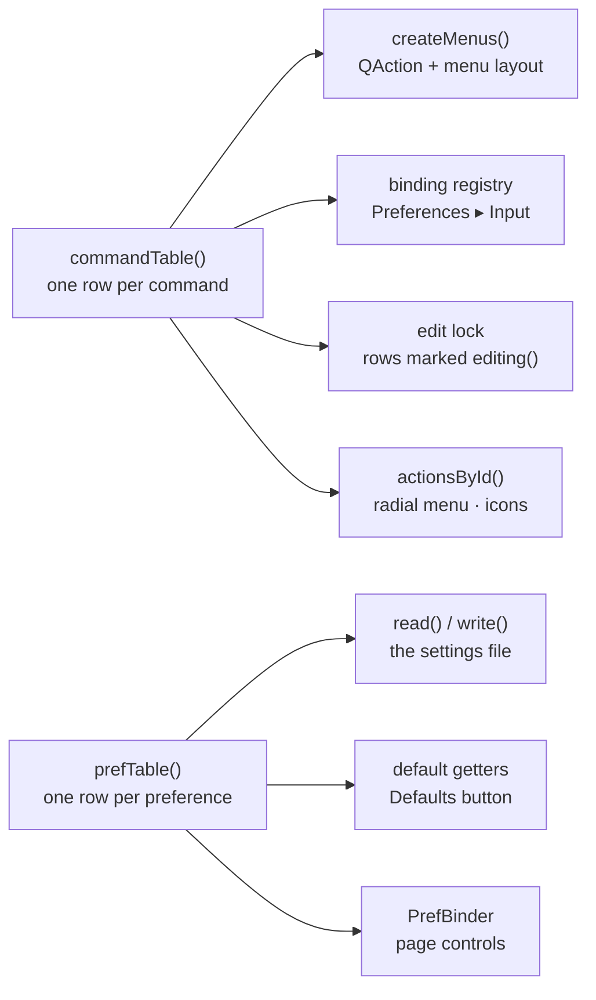

# Klusters commands and preferences

A developer reference for the two tables the application's shell is built from:
the **command table** (every menu command) and the **preference table** (every
value of the settings file). Read this before adding or moving a command, adding
a preference, or touching the Preferences dialog.

Both tables follow one rule: **a thing is described in one row, and everything
that needs it is built from the row.** Before them a command was written in four
places and a preference in up to ten, and the places drifted: a command missing
from the edit lock's list stayed enabled during a recluster; a default written
twice had two values.

> When this document and the code disagree, the code wins; fix this document.
> The step-by-step recipes are in [RECIPES.md](../../../doc/dev/RECIPES.md) §2.6
> (an icon), §2.7 (a command), §2.8 (a preference).

**Contents:** [1. The pieces](#1-the-pieces) · [2. The command table](#2-the-command-table) ·
[3. The menus](#3-the-menus) · [4. Command ids](#4-command-ids) ·
[5. The preference table](#5-the-preference-table) · [6. The Preferences pages](#6-the-preferences-pages) ·
[7. The dialog](#7-the-dialog) · [8. Tests](#8-tests) · [9. Gotchas](#9-gotchas)

---

## 1. The pieces

| File | Role |
|---|---|
| `commandspec.h` | `CommandSpec` — one menu command |
| `klusters_commands.cpp` | `KlustersApp::commandTable()` (the rows) and `addCommand()` (a row → a `QAction`) |
| `klusters.cpp` `createMenus()` | creates the actions, and lays the menus out |
| `klusters.cpp` `registerInputBindings()` | mirrors the rows that have a category into the binding registry; registers the key commands that are not menu commands |
| `klusters_state.cpp` | `slotStateChanged()` (which commands a state allows — still lists, by hand) and the edit lock |
| `klusters_actionids.cpp`, `actionid.h` | `actionCatalog()` / `actionsById()`: a command's id for the radial menu and the icon table |
| `prefspec.h` | `PrefSpec` — one preference |
| `configuration_prefs.cpp` | `Configuration::prefTable()` (the rows) |
| `configuration.cpp` | `read()`, `write()`, `applyOldDefaults()` |
| `prefbinder.h/.cpp` | `PrefBinder` — page controls ↔ rows |
| `prefdialog.cpp`, `pref*.ui`, `pref*.cpp` | the dialog and its pages |
| `libklustersshared` `gui/page/pagekeynavigator.h` | the dialog from the keyboard |



---

## 2. The command table

`KlustersApp::commandTable()` returns one `CommandSpec` per menu command:

```cpp
t << CommandSpec("action.watershed", "Split", tr("&Watershed Split"), ON(triggered, slotWatershedSplit))
         .shortcut(Qt::SHIFT | Qt::Key_W).statusTip(tr("…")).editing();
```

| Part | Meaning |
|---|---|
| id | permanent name of the command (§4) |
| category | the group it is listed under in Preferences ▸ Input. **Empty: the command is in the menu only** and is not rebindable there (the mouse tools, which have key commands of their own; the toolbar toggles) |
| text | the menu text, with its mnemonic and ellipsis |
| `ON(signal, slot)` | the connection, when it is one signal to one member slot. Omitted: `createMenus()` wires it under its `addCommand` line (a lambda, an action group, `setData`) |
| `.shortcut()` | the default key. A rebound key is an override in the settings file, pushed onto the action by `applyInputOverridesToActions()` |
| `.statusTip()` `.toolTip()` | as named |
| `.checkable()` `.checked()` `.disabled()` `.enabledIf()` | the initial state. `checked` is set before the slot is connected, so the slot does not run for it |
| `.editing()` | it changes the clustering, its files or the cluster ids, or starts a job that does |

What is built from a row:

- **The action.** `addCommand(menu, id)` makes the `QAction` from the row. With a
  null menu it only creates it; the layout block places it (§3).
- **The registry entry.** `registerInputBindings()` calls `registerActionCommand`
  for every row with a category, in one loop. The command is `external`: Qt
  dispatches its shortcut, the registry lists it and carries a rebinding
  ([INPUT_SYSTEM.md](INPUT_SYSTEM.md) §3.2).
- **The edit lock's set.** `collectEditLockActions()` takes the rows marked
  `.editing()`. While a job runs they are disabled
  ([CONCURRENCY.md](CONCURRENCY.md) §7.4).
- **The id** everywhere a command is named (§4).

Not built from the row, still by hand:

- **Which states allow a command**: the lists of `slotStateChanged()`.
- **The icon**: a row of `actionicons.cpp`, keyed by the command's id
  (STANDARDIZATION.md §2.11).
- **The `QAction*` member** in `klusters.h`.
- **The key commands that are not menu commands** (T, the tool keys, Enter on a
  lasso, the child-view keys): `registerInputBindings()`. One that edits begins its
  `invoke` with `refuseWhileBlocked()` — the edit lock disables actions, and a key
  command is not one.

---

## 3. The menus

The menu bar: **File · Edit · View · Clusters · Split · Recluster · Spikes ·
Hierarchy · Tools · Displays · Plugins · Help.** A command is in the menu of what
it does: whole clusters (Clusters), cutting one (Split), spike times and features
(Spikes).

Two ways a command gets its place in `createMenus()`:

- **File, Hierarchy, Tools, Displays, Help** are filled where the command is
  created: `mNewCluster = addCommand(toolsMenu, "tools.newCluster");`, with
  `addSeparator()` between.
- **Edit, View, Clusters, Split, Recluster, Spikes** and the submenus of View
  (Waveforms, Correlations, Traces, Toolbars and Panels) are filled by the
  **layout block** at the end of the function. Their commands are created with
  `addCommand(nullptr, id)`, in any order, and placed by lists:

  ```cpp
  fill(splitMenu, { mWatershed, mDipSplit, mSplitByKnn, mPartitionByTime, nullptr,   // nullptr: a separator
                    mSplitBurstFollowers, mSplitOffSpurious, nullptr, … });
  ```

Moving a command to another menu is moving its name to another list. Its id, its
key, a stored binding and a stored radial-menu layout are unaffected.

Sort Clusters and Recluster ▸ Engine are menus held as members
(`mClusterSortMenu`, `mReclusterEngineMenu`): the cluster view's context menu
reuses the first, and the installed `recluster` plugins are added to the second
at run time.

---

## 4. Command ids

A command has one id, used wherever it is named outside the code that creates it:

| Where | What is stored |
|---|---|
| the binding registry and Preferences ▸ Input | the row's id, for rows with a category |
| a rebound key (`[inputBindings]` of the settings file) and a keymap layout | the id |
| a radial-menu layout (`[radialMenu]`) | the id |
| `actionicons.cpp` | the id |
| the self-test harness (`actionsEnabled`, `commandDump`) | the id |

`actionCatalog()` gives each menu-bar action its id: the registry id, else the
row's id, else — for an entry with no row, which is what a plugin adds —
`menu:` + its menu path. `actionsById()` resolves all of them, and also:

- an action's current menu path;
- the menu paths of the 14 commands that were named by one before the menus were
  redistributed on 2026-11-24 (`menu:Settings/Preferences` → `edit.preferences`),
  and `menu:Actions/Recluster/Engine/<plugin>`.

So an id stored by an earlier version still names its command.
`test_command_ids_stable.py` holds the list of that day and checks each resolves.

**An id is permanent.** It says what the command is, not where it is
(`action.watershed` is in the Split menu). Renaming one orphans every stored
binding and layout that names it; if it must change, add the old id as an alias
in `actionsById()` and move stored bindings once in `Configuration::read()` (the
`hierarchy.dissolveParentKey` change is the model).

**An id is unique across the registry.** A second command registered under an
existing id *replaces* the first, silently. `BindingRegistry::replacedIds()`
records it and `test_command_table.py` fails on it.

---

## 5. The preference table

`Configuration::prefTable()` returns one `PrefSpec` per value of the settings
file (113 rows):

```cpp
t << prefVia("General", "knnK", &Configuration::knnK, 10, &Configuration::setKnnK).on("knnKSpinBox");
```

| Kind of row | The stored value goes… |
|---|---|
| `pref(group, key, &member, default)` | into the member |
| `pref(…, default, limit)` | into the member through `limit`, a function of the value |
| `prefVia(group, key, &member, default, &setter)` | through the setter, which holds the limits |
| `prefField(group, key, &structMember, &Struct::field)` | into one field of a settings struct (`CoreCut`, `HoverSpike`, `WaveformQuality`); the default is the struct's own, and `read()` passes the struct through its setter afterwards, which checks it as a whole |

What is built from a row:

- **`read()`**: for each group, `row.set(config, settings.value(key, default))`.
- **`write()`**: `settings.setValue(key, row.get(config))`. Every row is written
  every time.
- **The default**: `prefDefault("key")`. The `get…Default()` accessors that used
  to repeat a number return it; the Defaults button and a missing key therefore
  agree.
- **The page control** named by `.on(…)` (§6).

**Limits.** A value read from the file passes the same limit as a value set from
the dialog. A row without one takes whatever the file holds; give every numeric
row a limit (`prefVia` when the setter has it, else the `limit` argument with the
range the page's control allows).

**A changed default.** Every `write()` stores every value, so a settings file
written before a default changed holds the old default as if it had been chosen.
Changing a default therefore takes two edits: the row, and a one-time change in
`Configuration::applyOldDefaults()` — "a stored value equal to the old default
becomes the new one, once" — recorded by a flag that `write()` stores, so that
the same value set by hand afterwards is kept. The undo depth (2 → 20) and the
realign threshold (0.70 → 0.10) are there.

Not in the table: the key bindings, the keymap layouts and the radial-menu
layout (not single values; their own groups of the file), the per-plugin defaults
(`PluginSettings`), and window geometry.

---

## 6. The Preferences pages

A page is a `.ui` file (Designer) and a small class. A setting on it needs **its
control in the `.ui` and its name in the row**; `PrefBinder` does the rest for
every row whose control it finds under the dialog:

| | |
|---|---|
| `load(config)` | the configuration's value → the control |
| `apply(config)` | the control's value → the configuration, through the row's `set` (its limits) |
| `restoreDefaults()` | the row's default → the control |
| `changed()` | emitted when the user alters one; the dialog enables Apply |

| Control | Holds | Row |
|---|---|---|
| check box | a flag | `.on("name")` |
| spin box, double spin box | a number | `.on("name")` |
| line edit | a text; or a number typed in — text that is not a number gives the default | `.on("name")` |
| combo box | the entry's index; for a flag, first entry off, second on | `.on("name")` |
| combo box | the value each entry stands for | `.on("name", { 0, 2, 4 })` |
| radio buttons | the index of the one checked | `.on("first|second|third")` |
| `QColorButton` | a colour | `.on("name")` |

74 settings are bound. A row naming a control that no page has is reported
(`PrefDialog::unboundPreferenceRows()`), and `test_settings_file.py` fails on it.

**A control that enables others** does so from its own signal, connected in the
page's constructor, and the constructor applies it once for the initial state
(loading a value equal to the `.ui`'s sends no signal). See `PrefSession` and the
crash-recovery interval.

**By hand**, with a `set…` / `get…` on the page and four lines in
`prefdialog.cpp` (`updateDialog()`, `updateConfiguration()`, `restoreDefaults()`,
the `enableApply` connection):

- a setting whose `set…` on the page does more than show it: the recluster engine
  (re-reads the plugins' stored defaults for its summary), the recluster chunking
  (enables the minutes box);
- a control built in code without an object name (the fiber-kit command);
- the three settings structs, set as a whole;
- pages that are not lists of values: Input (generated from the registry —
  [INPUT_SYSTEM.md](INPUT_SYSTEM.md)), Radial menu, the per-plugin pages
  (generated from the descriptors — [PLUGIN_API.md](PLUGIN_API.md)), the channel
  lists of the Waveform view page, the theme.

Every page is put in a scroll area by `PrefDialog` (`subPage`), held at the height
it was laid out for (`test_pref_pages.py`).

---

## 7. The dialog

`PrefDialog` is a `QPageDialog` (libklustersshared) with a tree of three groups.

- **Flow.** `KlustersApp::executePreferencesDlg()` → `updateDialog()` (binder
  `load`, then the hand-written pages) → the user edits → **OK / Apply** →
  `updateConfiguration()` (binder `apply`, the hand-written pages, the registry,
  the plugins) → `settingsChanged()` → `KlustersApp::applyPreferences()`, which
  stores the settings (`Configuration::write()`) and pushes the values into the
  open document and views.
- **Defaults** asks first, then `restoreDefaults()`: every page, in the controls
  only; nothing is stored until OK or Apply.
- **Keyboard** (`PageKeyNavigator`): two levels. In the page list, Enter goes into
  the page shown and Tab goes round the list and the dialog's buttons. In a page,
  Tab goes round its settings and stays in the page, Space toggles, Enter acts on
  the setting and never presses OK, Esc goes back to the list. Ctrl+Enter is OK
  from anywhere. A key editor of the Input page keeps Enter and Esc. A new page
  gets this for nothing as long as its controls take focus by Tab.

---

## 8. Tests

All are self-tests (`src/klusters/test/selftest/`, `ctest -L selftest`); the two
snapshot tests are the check for any change to a table.

| Test | Pins |
|---|---|
| `test_command_table.py` + `commands.golden.json` | every menu command: menu, order, text, keys, tips, flags, whether the edit lock holds it; the registry's entries by id; no id registered twice. Two states (a flat session; the child view) |
| `test_command_ids_stable.py` + `command_ids_before_20261124.txt` | every id of before the menus were redistributed still resolves |
| `test_edit_lock.py` | no editing command is enabled during a recluster or a realign; a key command that edits does nothing; the same commands are enabled afterwards |
| `test_settings_file.py` + `settings.golden.json` | every key of the settings file after read + write, in seven cases: no file, changed values, both limits, old defaults, Preferences opened and OK pressed, Defaults; and special values through the dialog (a combo box of values, radio buttons, a colour, typed numbers) |
| `test_undo_depth_migration.py`, `test_realign_threshold_migration.py`, `test_dissolve_key_binding_migration.py` | each one-time change of a stored value, in its four cases |
| `test_pref_keyboard.py` | the two keyboard levels of the dialog |
| `test_pref_pages.py` | every page scrolls and is drawn at its height |

A deliberate change (a new command, a moved one, a new preference, a changed
default) makes a snapshot test fail. Run it with `--update`, **read the diff** of
the golden file — it should be exactly your change — and commit it with the code.

---

## 9. Gotchas

- **Two commands, one id.** The registry keeps one command per id. A key command
  given the id of a menu command replaces it: the menu command vanishes from
  Preferences ▸ Input and a rebinding of the key also lands on the menu action.
- **A category makes a command a registry entry.** Its id must then differ from
  every key command's (`tools.newCluster` is a key command *and* a row without a
  category — the row must stay without one).
- **The edit lock is the row's `.editing()` and nothing else.** A command that
  starts a job and is not marked stays enabled during other jobs. A key command
  that edits needs its own `refuseWhileBlocked()`.
- **`checked()` runs no slot.** A checkable command that must act on its initial
  state does so where it is wired.
- **A preference key is permanent**, like a command id: settings files hold it.
- **A default exists once, in the row.** Do not repeat the number in a page
  (`return ok ? v : 30.0`) or in a `get…Default()`; ask `prefDefault("key")`.
- **A changed default is not a one-line change** (§5): without the one-time
  change, everyone who ever saved their preferences keeps the old value.
- **The binder's value has the row's type.** A combo box on an integer row gives
  its index; give the row `choices` when the entries stand for other values, or
  the index is what is stored.
- **`QColorButton` is a `QPushButton`.** The binder tests for it before buttons;
  a new kind of control that derives from a bound one needs the same care.
- **The settings file in a test** is private to the run (`<work dir>/cfg/
  neurosuite-3/klusters.conf`); the group `General` appears there as
  `[%General]`, and the ungrouped keys as `[General]`.
